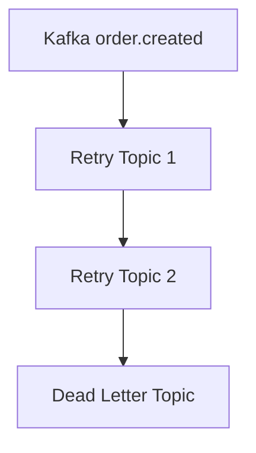

## 1. The Naive Workflow: First Failure Strikes


When you're building your first event-driven service with Kafka, the initial implementation feels natural and clean. You have a REST endpoint that saves an order to the database and publishes an event to Kafka. The code is straightforward, and in development, everything works perfectly.

```java
@PostMapping("/orders")
@Transactional
public ResponseEntity<Order> createOrder(@RequestBody CreateOrderRequest req) {
    Order order = repository.save(new Order(req));// persists in DB
    OrderEvent event = buildOrderCreatedEvent(order);
    kafkaTemplate.send("order.created", order.getId(), event);
    return ResponseEntity.ok(order);
}
```

Here's what actually happens in production: the database transaction commits successfully, writing your order to PostgreSQL. Then, just as your code attempts to send the event to Kafka, the network hiccups. The Kafka broker never receives the message. Your order exists in the database, but no downstream service knows about it. Payment never gets processed. Inventory is never reserved. The customer's order vanishes into a black hole.

The inverse failure is equally painful. Sometimes the Kafka send succeeds, but an exception gets thrown afterward—perhaps during some post-processing logic. Spring rolls back the transaction, removing the order from the database. But the event? It's already sitting in Kafka, ready to be consumed. Now you have phantom payment attempts for orders that don't exist.

I've debugged this scenario more times than I'd like to admit. The fundamental issue is that you're performing two separate writes—one to PostgreSQL, one to Kafka—and treating them as if they're atomic when they're not. Database transactions can't span external systems. This is the dual-write problem, and it's the first reliability wall every Kafka developer hits.

- - -

## 2. Transactional Outbox: Escaping Dual-Write Hell


The transactional outbox pattern emerged from a simple insight: if you can't make two separate systems transactional, make one system the source of truth and derive the other from it. Instead of writing to both the database and Kafka in the same code path, you write both the business data and the *intent to publish* into the same database transaction. A separate process reads that intent and publishes to Kafka.

Your schema needs to capture this intent, so you add an outbox table alongside your business tables:

```sql
CREATE TABLE order_outbox (
    event_id UUID PRIMARY KEY,
    aggregate_id UUID NOT NULL,
    event_type VARCHAR(64) NOT NULL,
    payload JSONB NOT NULL,
    occurred_at TIMESTAMPTZ NOT NULL,
    published_at TIMESTAMPTZ,
    publication_status VARCHAR(32) NOT NULL
);
```

Now when an order is created, both records are written in a single transaction. If the transaction commits, both the order and the outbox entry are durable. If it rolls back, neither exists. You've achieved atomicity.

```java
@Transactional
public void saveOrderAndOutbox(Order order) {
    orderRepository.save(order);
    OutboxEvent outboxEvent = new OutboxEvent(order);
    outboxRepository.save(outboxEvent);
}
```

A background publisher polls the outbox table and pushes events to Kafka. This decouples the critical write path from Kafka's availability. If Kafka is down, orders still get saved—the events just accumulate in the outbox until Kafka recovers.

```java
@Scheduled(fixedDelay = 500)
public void publishOutboxEvents() {
    List<OutboxEvent> events = outboxRepository.findUnpublished();
    for (OutboxEvent event : events) {
        try {
            kafkaTemplate.send("order.created", event.getAggregateId(), event);
            event.markPublished();
            outboxRepository.save(event);
        } catch (Exception e) {
            // Remain unpublished, retry on next poll
        }
    }
}
```

The outbox pattern solves the dual-write problem, but it introduces a new reality: your system now guarantees *at-least-once* delivery, not *exactly-once*. If the publisher successfully sends to Kafka but crashes before marking the event as published, it will send the same event again on the next poll. This isn't a bug—it's a deliberate trade-off. The guarantee you get is that if an order exists, the intent to publish will eventually succeed. The cost is that downstream consumers must handle duplicates gracefully.

Some teams use Change Data Capture tools like Debezium to stream outbox changes directly to Kafka, avoiding the polling overhead. In my experience, the polling approach works fine for most workloads and keeps the architecture simpler. Add CDC when you have clear evidence that polling is a bottleneck.

[Read about the Outbox pattern](https://microservices.io/patterns/data/transactional-outbox.html)

- - -

## 3. Idempotent Consumers: Payment's Reality Check

Once you've accepted that events can arrive more than once, the next challenge is making sure your business logic doesn't execute more than once. Kafka's delivery guarantees are about messages, not side effects. If the payment service receives the same `OrderCreated` event twice, it shouldn't charge the customer twice.

In production systems, I've found that the cleanest approach is to track which events you've already processed. Before doing any business logic, check if you've seen this specific event before. If you have, skip it. If you haven't, record it and proceed.

```java
@Transactional
@KafkaListener(topics = "order.created")
public void consumeOrderCreated(OrderEvent event) {
    if (eventRepository.existsByEventId(event.getEventId())) {
        return; // Already processed: idempotent
    }
    eventRepository.save(new ProcessedEvent(event.getEventId()));
    paymentRepository.authorizePayment(event.getOrderId());
}
```

The key is that checking and recording happen in the same transaction as the business logic. Either all three happen (check, record, authorize) or none of them do. This table structure is deliberately simple:

```sql
CREATE TABLE processed_events (
    event_id UUID PRIMARY KEY,
    processed_at TIMESTAMPTZ DEFAULT now()
);
```

The event ID must be stable across retries. You can't use a timestamp or a random UUID generated during publishing—those change on each attempt. The ID needs to represent the real-world event: "Order 12345 was created." If the outbox publisher sends that event three times due to crashes, all three messages must carry the same event ID.

It's worth distinguishing between Kafka's producer idempotence and consumer idempotence. When you enable idempotent producers in Kafka, you're preventing duplicate messages caused by producer retries and network issues at the protocol level. That's valuable, but it doesn't prevent your business logic from executing twice if the same conceptual event arrives from two different sources or publishing attempts. Consumer idempotence is about protecting your business invariants, not just message delivery semantics.

- - -

## 4. Retry Topics: Handling Temporary Glitches Without Partition Stalls


Real distributed systems are filled with transient failures. The payment provider times out but succeeds on retry. The inventory database is under load and rejects connections for thirty seconds. An external API returns 503 but recovers moments later. Traditional retry approaches handle these by blocking: catch the exception, sleep, try again. The problem is that while you're sleeping, your Kafka consumer is stuck. No other messages in that partition get processed until the retry succeeds or gives up.

Spring Kafka's retry topics solve this by moving failed messages to separate topics with delayed consumption. When a message fails, instead of blocking the consumer, you route it to a retry topic and immediately move on to the next message in the original partition.

```java
@RetryableTopic(
    attempts = 3,
    backoff = @Backoff(2000),
    dltTopicSuffix = ".dlt"
)
@KafkaListener(topics = "order.created")
public void handleOrderCreated(OrderEvent event) {
    paymentProvider.authorize(event);
}
```

Behind the scenes, this creates topics like `order.created-retry-0` and `order.created-retry-1`. Failed messages get republished to these topics with headers indicating retry count and timing. Separate consumers with appropriate delays process the retry topics. After exhausting all retries—or encountering non-retryable errors like malformed JSON—the message lands in the Dead Letter Topic.



What matters here is that the original partition keeps flowing. A single problematic message doesn't create head-of-line blocking for everything behind it. The trade-off is operational complexity: more topics to monitor, more consumers to configure, more moving parts in your architecture. In high-throughput systems processing thousands of messages per second, this trade-off is absolutely worth it. In low-volume systems, blocking retries might be simpler.

One pattern I've learned to avoid: infinite retries. If a message has failed ten times over several hours, it's not going to magically succeed on attempt eleven. Something is fundamentally broken—bad data, a changed API contract, or a systemic issue. Continuing to retry just creates noise and burns resources. Set reasonable limits and route persistent failures to the DLT for human investigation.

[Spring Kafka Retry Topics Reference](https://docs.spring.io/spring-kafka/reference/retrytopic/how-the-pattern-works.html)

- - -

## 5. Dead Letter Topic (DLT): The Final Rest Stop

Some messages simply can't be processed. The event schema changed but wasn't versioned properly. A required external service was permanently deprecated. The data violates business rules in ways that retrying won't fix. For these cases, you need a place where failed messages go to die—or more accurately, go to wait for manual intervention.

The Dead Letter Topic is that place. When Spring Kafka exhausts all retries, or when you explicitly classify an error as non-retryable, the message gets routed to a DLT, typically with a suffix like `.dlt`.

```java
@KafkaListener(topics = "order.created.dlt")
public void handleDlt(OrderEvent event, @Header(KafkaHeaders.RECEIVED_TOPIC) String topic) {
    log.error("DLT - manual intervention: {} from {}", event, topic);
    // Optionally trigger notification, alerting, triage, or manual fix
}
```

The DLT handler's job isn't to fix the problem automatically—if that were possible, you'd have done it in a retry. Instead, it's about making the failure visible and manageable. In production, I've connected DLT handlers to alerting systems, written failed messages to dedicated databases for analysis, and created dashboards showing DLT volume trends.

One critical lesson: treat the DLT as an operational queue with clear ownership. Someone on your team needs to be responsible for monitoring it, investigating failures, and deciding what to do with them. Some messages can be fixed and replayed. Others reveal bugs that need code fixes. Some are legitimate business exceptions that require human judgment.

Never set up automatic replay from the DLT without understanding why messages landed there. I've seen systems create infinite loops where corrupted messages bounce between the main topic and the DLT forever, consuming resources and creating alert fatigue. Replay should be a deliberate, controlled act performed after root cause analysis.

Using a Kafka UI tool like Conduktor or Kafka UI makes DLT management dramatically easier. You can inspect message contents, see headers with retry history and error details, and selectively replay messages after fixes are deployed.

[DLT and retry strategies](https://docs.spring.io/spring-kafka/reference/retrytopic/dlt-strategies.html)

- - -

## 6. Consumer Groups, Partitions, Ordering: Concurrency Without Chaos


Kafka achieves horizontal scalability through partitioning. A topic splits into multiple partitions, and each partition is independently consumable. When you run multiple instances of a service, Kafka assigns partitions to different instances, allowing parallel processing. Your maximum concurrency is bounded by the number of partitions—if you have four partitions, running eight consumer instances doesn't increase throughput.

Partitioning creates a subtle but critical ordering constraint: Kafka guarantees message order within a partition, but not across partitions. If messages for the same order land in different partitions, they might be processed out of sequence. The solution is to use the order ID as the message key when producing events.

```java
kafkaTemplate.send("order.created", orderId, event)
```

Kafka's partitioning algorithm ensures that messages with the same key always route to the same partition. All events for order 12345 will be processed sequentially on one partition, while events for order 67890 process in parallel on a different partition. You get both order preservation where it matters and parallelism where it doesn't.

When you deploy multiple instances of payment-service, you can watch partition assignment in action. Tools like Kafka UI show which consumer in the group owns which partition, current lag, and processing rates. If you see uneven distribution—one consumer handling three partitions while another handles one—Kafka's rebalancing protocol should eventually correct it.

The partition count decision is architectural. Too few partitions and you can't scale beyond a handful of consumers. Too many and you face operational overhead: more files on disk, more metadata to manage, longer rebalance times. I've found that starting with partition counts that match your expected consumer instances, then increasing if you hit throughput limits, works well for most systems.

One trap to avoid: assuming global ordering when you actually have per-partition ordering. If you partition by order ID but expect all events across all orders to maintain creation timestamp order, you'll be disappointed. Partition ordering is strict and reliable; cross-partition ordering doesn't exist without additional application-level logic like vector clocks or sequence numbers.

- - -

## 7. Exactly Once Semantics: Understanding the Boundaries


The term "exactly once" in Kafka generates more confusion than almost any other concept. Developers hear it and assume it means their business logic executes exactly once per event, no matter what failures occur. That's not what Kafka's exactly-once semantics guarantee, and understanding the actual scope is crucial for building reliable systems.

Kafka offers two related features: idempotent producers and transactions. Idempotent producers prevent duplicate messages caused by producer retries. When you enable `enable.idempotence=true` and set `acks=all`, Kafka assigns sequence numbers to messages and deduplicates at the broker level. This prevents the scenario where a network timeout causes the producer to retry, resulting in the same message appearing twice in the topic.

Kafka transactions go further, allowing you to atomically commit both consumed offsets and produced messages. This is powerful for consume-transform-produce workflows common in stream processing.

```java
@Bean
public KafkaTemplate<String, InventoryEvent> kafkaTemplate(ProducerFactory pf) {
    pf.setTransactionIdPrefix("inv-tx-");
    return new KafkaTemplate<>(pf);
}

@KafkaListener(topics = "payment.outcome")
public void processPayment(PaymentEvent payment, Acknowledgment ack) {
    kafkaTemplate.executeInTransaction(t -> {
        InventoryEvent inv = new InventoryEvent(payment);
        t.send("inventory.reserve", payment.getOrderId(), inv);
        ack.acknowledge();
        return true;
    });
}
```

Within this transaction, either both the inventory event is produced and the payment event's offset is committed, or neither happens. If the process crashes mid-transaction, recovery will reprocess the payment event, but because the offset wasn't committed, no duplicate inventory event exists in Kafka.

Here's the crucial boundary: this atomicity applies only to Kafka records and offsets. The moment you interact with external state—writing to a database, calling a payment API, updating a cache—you've left the transaction's protection. If you call `paymentRepository.save()` inside that transaction block and then crash before committing, the payment record persists but the Kafka offset doesn't advance. On restart, you'll process the same message again and create a duplicate payment.

This is why you still need the outbox pattern and idempotent consumers even with Kafka transactions enabled. Producer idempotence handles delivery-level duplicates in Kafka itself. Kafka transactions provide atomic consume-produce within Kafka's ecosystem. Business idempotency protects your domain invariants from duplicate execution. These are complementary layers, not alternatives.

In practice, I've found that enabling idempotent producers is a no-brainer—it's essentially free and prevents a class of problems. Kafka transactions make sense for stream processing topologies where you're continuously transforming Kafka events into other Kafka events. For services that interact heavily with databases or external APIs, the outbox pattern combined with consumer idempotency is often simpler and more appropriate.

[Kafka Delivery Semantics](https://docs.confluent.io/kafka/design/delivery-semantics.html)

- - -

## 8. Putting It Together: Complete Scenario Walkthrough

Understanding patterns in isolation is valuable, but seeing how they interact reveals their true power. When a client creates an order, the request hits the order-service REST endpoint. Inside a single database transaction, both the order record and an outbox entry are written to PostgreSQL. This transaction either succeeds completely or fails completely. There's no scenario where the order exists without the outbox entry, or vice versa.

The outbox publisher runs independently, polling the `order_outbox` table every few hundred milliseconds. When it finds unpublished events, it sends them to the `order.created` topic using KafkaTemplate. Because the producer is configured with idempotence enabled, network-level duplicates are prevented. After successful delivery, the publisher updates the outbox row's status to published. If the publisher crashes between sending to Kafka and updating the database, the next poll cycle will send the event again—but that's acceptable because all consumers are idempotent.

In the payment-service, a consumer listens to `order.created`. The first thing it does, before any business logic, is check if it's already processed this event ID. If so, it returns immediately. If not, it records the event ID in the `processed_events` table and proceeds to call the payment provider. Both the recording and the payment authorization happen in the same database transaction, ensuring atomicity.

When the payment provider times out, Spring Kafka's retry mechanism catches the exception and republishes the message to `order.created-retry-0` instead of blocking the consumer. The original partition continues processing new orders while the failed payment attempt waits in the retry topic with a backoff delay. After two seconds, a retry consumer processes it. If it fails again, it moves to `order.created-retry-1` with a longer delay. After exhausting all retries, it lands in `order.created.dlt`.

To verify idempotency, try deliberately publishing the same event twice with identical event IDs. Only one payment gets authorized, which you can confirm by checking the `processed_events` table and the payment provider's records. To verify retry handling, inject a transient failure into the payment provider—return a timeout error that clears after ten seconds. Watch the message flow through retry topics in Kafka UI, eventually succeeding.

For DLT validation, publish a malformed event with a missing required field. The consumer will fail, exhaust retries quickly (since this is non-retryable), and route the message to the DLT. In Kafka UI, you can inspect the DLT message and see headers containing error details and retry history.

Throughout this flow, all messages for the same order ID route to the same partition because you're using order ID as the key. You can scale the payment-service to multiple instances, and Kafka will distribute partitions among them. Each instance processes different orders in parallel, but events for any single order are always processed sequentially.

```bash
# Sample: Get current orders
docker-compose exec order-service curl http://localhost:8080/orders

# View topics & DLT events in Kafka UI
```

What you've built isn't just code—it's a system with explicit guarantees and well-defined failure modes. Orders won't disappear silently. Duplicate processing won't cause duplicate charges. Transient failures won't stall the entire system. Permanent failures won't create infinite retry loops. Each pattern addresses a specific class of failure, and together they form a resilient whole.


> **Diagram context:** This workflow covers order creation, payment, inventory, and notification. It omits classic distributed failures—like dual writes, duplicate deliveries, ordering issues, stalled partitions, dead-lettered messages, and the exact limits of Kafka's transactional features.

- - -

## Key Takeaways: Reliability is Layered, Not Magic

Building reliable event-driven systems isn't about finding the one true pattern that solves everything. It's about layering complementary patterns that each address specific failure modes. The outbox pattern prevents dual-write drift. Idempotent producers prevent delivery-level duplicates within Kafka. Idempotent consumers prevent duplicate business effects. Retry topics prevent head-of-line blocking. DLTs prevent infinite failure loops. Partitioning enables scalability while preserving ordering where it matters.

Each layer has costs. The outbox adds database writes and polling overhead. Idempotency tracking adds tables and queries. Retry topics add operational complexity. DLTs require monitoring and ownership. You might look at all this machinery and think the naive approach—just save to the database and send to Kafka—is simpler and therefore better. It is simpler, until the first failure exposes its fragility.

The systems I've seen fail in production aren't the ones with sophisticated reliability patterns. They're the ones that assumed happy paths would dominate, that networks wouldn't fail, that processes wouldn't crash, that external services would always respond quickly. They optimized for development speed and paid the price in operational pain.

What's interesting about these patterns is that they don't just prevent failures—they make failures visible and manageable. When something goes wrong, you have tools to understand what happened. The DLT shows you what couldn't be processed. The outbox shows you what hasn't been published yet. Idempotency tables show you what you've already handled. Monitoring tools show partition lag and retry volume. Visibility enables operational excellence.

The exactly-once semantics discussion reveals an important principle: understand what guarantees your infrastructure actually provides versus what you wish it provided. Kafka transactions are powerful within their scope, but that scope is narrower than many developers expect. Knowing the boundaries lets you design compensating mechanisms instead of relying on guarantees that don't exist.

In practice, I've found that most reliability bugs come from implicit assumptions rather than missing patterns. Assuming that if the database commit succeeds, Kafka send will too. Assuming that processing a message once means your business logic executes once. Assuming that message order is global rather than per-partition. Making these assumptions explicit, then systematically addressing each one with appropriate patterns, is how you build systems that survive production.

- - -

## What the Workflow Can Survive Now

This architecture withstands a remarkably broad range of failures. Network partitions between the order-service and Kafka don't cause data loss—the outbox accumulates events until connectivity restores. Order-service crashes don't create inconsistencies—the database transaction ensures either both the order and outbox entry exist or neither does. Publisher crashes after sending to Kafka but before marking as published result in duplicate events, but idempotent consumers ignore them.

Payment provider timeouts don't stall the system—retry topics handle them with backoff while other orders process normally. Permanent payment failures don't create infinite loops—they land in the DLT after exhausting retries. Malformed events don't bring down consumers—they're routed to the DLT where they can be investigated safely. Scaling the payment-service from one instance to ten doesn't cause message loss or reordering issues—Kafka's consumer groups and partitioning handle it transparently.

Perhaps most importantly, the system's failure modes are well-defined and observable. You're not debugging mysterious data inconsistencies or chasing phantom events. When something goes wrong, you have specific places to look: the outbox table for unpublished events, the DLT for unprocessable messages, idempotency tables for processing history, Kafka UI for partition lag and consumer health.

- - -

## Workflow Reliability Checklist

The patterns we've covered form a reliability checklist that you can apply to any event-driven system. Atomic writes with the outbox pattern ensure business data and publication intent are consistent. Stable event IDs that represent real-world occurrences enable idempotency. Producer idempotence with `acks=all` and `enable.idempotence=true` prevents delivery duplicates at the protocol level. Consumer idempotency with processed event tracking prevents duplicate business effects.

Non-blocking retries via retry topics maintain system throughput during transient failures. DLT handlers with monitoring and ownership prevent infinite failure loops and create operational visibility. Kafka keying by business identifiers preserves ordering per entity while enabling parallelism across entities. Understanding exactly-once semantics boundaries prevents over-reliance on infrastructure guarantees that don't extend to external state.

* Atomic write: business data + outbox row
* Stable event IDs per real-world action
* Idempotent producer: `acks=all`, `enable.idempotence=true`
* Idempotent consumer: track processed event IDs
* Non-blocking retries via retry topics
* DLT handler, with monitoring and ownership
* Kafka keying by business ID for partition ordering
* Clear Exactly Once Semantics boundary

- - -

## Next Steps: Testcontainers and Failure Injection

Patterns on paper are one thing. Patterns that survive actual failures are another. The next step in building confidence in this architecture is rigorous testing with deliberate failure injection. Testcontainers makes this practical by running real Kafka brokers and PostgreSQL databases in Docker containers during integration tests.

Write tests that crash the outbox publisher mid-send and verify duplicate detection. Simulate network partitions between services and confirm that the outbox accumulates events. Send malformed events and validate they reach the DLT without taking down consumers. Scale consumer instances up and down during load and verify partition rebalancing maintains correctness. These aren't nice-to-have tests—they're how you verify that your reliability patterns actually work.

The goal isn't to prevent all failures. Failures will happen. The goal is to ensure that when they do, your system degrades gracefully, maintains its invariants, and provides the visibility needed to understand and recover. That's the difference between a system that's theoretically reliable and one that's actually reliable in production.

- - -

## Citations / Further Reading

* [11 Kafka Design Patterns - Reliability & Ordering Deep Dive](https://mvineetsharma.medium.com/11-kafka-design-patterns-reliability-ordering-deep-dive-6c749a897302)
* [How to scale Kafka maintaining Order of events](https://dev.to/amitjkamble/kafka-ordering-in-the-real-world-how-to-scale-without-killing-performance-37fo)
* [How to Handle Message Ordering in Kafka Partitions](https://oneuptime.com/blog/post/2026-01-24-handle-message-ordering-kafka-partitions/view)
* [Kafka Topic Design Guidelines](https://www.conduktor.io/glossary/kafka-topic-design-guidelines)
* [Spring Kafka Retry Topics](https://docs.spring.io/spring-kafka/reference/retrytopic/how-the-pattern-works.html)
* [Kafka Delivery Semantics](https://docs.confluent.io/kafka/design/delivery-semantics.html)